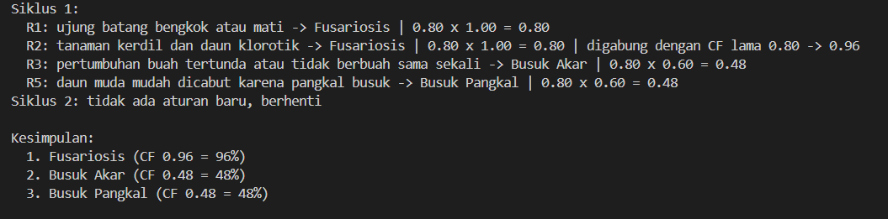
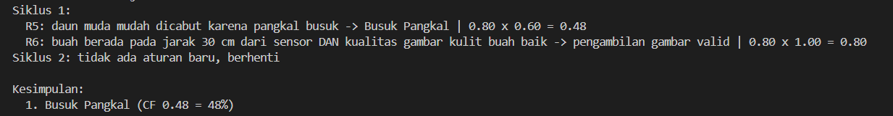
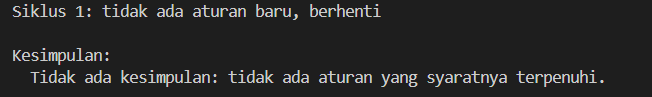

ai-tugas5-F1D02410113# Sistem Pakar Kondisi Tanaman dan Buah Nanas

Tugas Kecerdasan Buatan (Materi 5): Membuat Sistem Pakar Sederhana.

## 1. Identitas

- Nama : Gayatri Pradnya Aira Putri
- NIM  : F1D02410113

## 2. Topik dan cara menjalankan

**Topik:** nanas (*Ananas comosus*), yaitu diagnosis tiga penyakit tanaman (Fusariosis, Busuk Akar, Busuk Pangkal) dan penentuan tingkat kematangan buah (mentah, matang, ranum) menurut warna kulit. Topik ini bukan kesehatan manusia.

**Bahasa:** Python 3 (diuji pada Python 3.12). Tidak perlu menginstal library apa pun; hanya memakai `json` dan `sys` bawaan Python.

**Cara menjalankan:**

```
python sistem_pakar_nanas.py
```

(di macOS/Linux pakai `python3`). Program membaca `kb_nanas.json` yang ada di folder yang sama; file aturan lain bisa diberikan sebagai argumen: `python sistem_pakar_nanas.py kb_lain.json`.

**Cara menjawab:** setiap pertanyaan dijawab dengan angka 0 sampai 5 (skala keyakinan Tabel 4 makalah S1):

| Angka | 0 | 1 | 2 | 3 | 4 | 5 |
|---|---|---|---|---|---|---|
| Arti | tidak | ragu-ragu | mungkin | sangat mungkin | hampir pasti | pasti |
| CF user | 0.0 | 0.2 | 0.4 | 0.6 | 0.8 | 1.0 |

**Isi repository:**

```
sistem_pakar_nanas.py   program (mesin inferensi ditulis sendiri)
kb_nanas.json           file aturan + daftar sumber + batas keberlakuan
screenshot/             tangkapan layar tiga kasus uji
README.md
```

## 3. Sumber dan tabel aturan

### Daftar sumber

| Kode | Judul | Penerbit | URL | Diakses |
|---|---|---|---|---|
| S1 | Penerapan Metode Certainty Factor untuk Diagnosa Penyakit Tanaman Nanas (Pratama, Saputri, Saprudin) | STMIK Dharma Wacana, Metro | https://e-jurnal.dharmawacana.ac.id/index.php/ir/article/download/140/pdf | 12 Nov 2026 |
| S2 | Perancangan Alat Pendeteksi Kematangan Buah Nanas dengan Menggunakan Mikrokontroler dengan Metode Convolutional Neural Network (Purba, Saragih, Silalahi, Sitepu). *Methotika: Jurnal Ilmiah Teknik Informatika* Vol. 2 No. 1, April 2022, hlm. 13-21 | Fakultas Ilmu Komputer, Universitas Methodist Indonesia | http://ojs.fikom-methodist.net/index.php/METHOTIKA | 12 Nov 2026 |

Keduanya makalah jurnal ilmiah, bukan media sosial atau forum. Nama jurnal dan tahun terbit S1 tidak tercantum di berkas PDF-nya.

### Tabel aturan

Aturan disimpan di `kb_nanas.json`; tiap aturan memuat `sumber` dan `rujukan` (bagian makalah asalnya). Kolom CF aturan adalah keyakinan pakar terhadap aturan tersebut.

| Aturan | IF | THEN | CF aturan | Sumber |
|---|---|---|---|---|
| R1 | ujung batang bengkok atau mati | Fusariosis | 1.00 | S1 Tabel 1 (G01), Tabel 3 |
| R2 | tanaman kerdil dan daun klorotik | Fusariosis | 1.00 | S1 Tabel 1 (G02), Tabel 3 |
| R3 | pertumbuhan buah tertunda atau tidak berbuah sama sekali | Busuk Akar | 0.60 | S1 Tabel 1 (G03), Tabel 3 |
| R4 | akar rusak dan tanaman kerdil | Busuk Akar | 0.80 | S1 Tabel 1 (G04), Tabel 3 |
| R5 | daun muda mudah dicabut karena pangkal busuk | Busuk Pangkal | 0.60 | S1 Tabel 1 (G05), Tabel 3 |
| R6 | buah pada jarak 30 cm dari sensor **AND** kualitas gambar kulit buah baik | **pengambilan gambar valid** | 1.00 | S2 Gambar 7, Kesimpulan butir 2 |
| R7 | kulit buah hijau gelap **AND** *pengambilan gambar valid* | buah mentah | 0.84 | S2 Bagian 2.4, Tabel 2 |
| R8 | kulit buah kuning kehijauan **AND** *pengambilan gambar valid* | buah matang | 0.80 | S2 Bagian 2.4, Tabel 2 |
| R9 | kulit buah oranye **AND** *pengambilan gambar valid* | buah ranum | 0.86 | S2 Bagian 2.4, Tabel 2 |

Ringkasan: 9 aturan, 6 kesimpulan akhir (3 penyakit, 3 tingkat kematangan). **R7, R8, R9 memakai hasil R6** (rantai aturan).

Asal nilai CF aturan:
- R1-R5: bobot pakar pada Tabel 1 S1 (G01 = 1.0, G02 = 1.0, G03 = 0.6, G04 = 0.8, G05 = 0.6); pasangan gejala-penyakit mengikuti Tabel 3 S1.
- R7-R9: akurasi per kelas pada Tabel 2 S2 (mentah 42/50 = 0.84, matang 40/50 = 0.80, ranum 43/50 = 0.86). Ini keputusan saya memakai akurasi sebagai ukuran keandalan aturan.
- R6: aturan syarat (bukan penilaian ketidakpastian), jadi CF = 1.0.
- Makalah S2 tidak menuliskan warna dalam teks; deskripsi warna (hijau gelap, kuning kehijauan, oranye) saya baca dari foto contoh pada Bagian 2.4.

### Catatan terhadap sumber (hasil analisis)

- **S1 salah hitung.** Contoh kasus Pak Dede menulis `0.8 + (0.4 x (1 - 0.8)) = 0.8 + 0.8` lalu `CFold1 = 0.16`; yang benar `0.8 + 0.08 = 0.88`. Langkah berikutnya (0.26, 0.45, 0.7) juga tidak bisa direproduksi. Hasil akhir "70%" tidak dipakai.
- **S1 menggabungkan gejala dari penyakit berbeda.** Menurut Tabel 3 S1, G01-G02 milik P01, G03-G04 milik P02, G05 milik P03, tetapi contoh menggabungkan kelimanya menjadi satu CF. CF hanya boleh digabung untuk kesimpulan yang sama, jadi program ini menggabungkan per penyakit. G06-G08 ada di Tabel 1 tetapi tidak dipetakan ke penyakit mana pun di Tabel 3, sehingga tidak saya jadikan aturan.
- **S2 tidak konsisten.** Tabel 1 menulis jumlah data 150 per kelas padahal training 40 + testing 10 = 50; Bagian 3.2 melaporkan akurasi uji 50% (15 dari 30), sedangkan Tabel 2 melaporkan 83,33% pada 150 data (yang kemungkinan mencakup data latih). Karena itu CF 0.80-0.86 pada R7-R9 kemungkinan terlalu optimistis.

## 4. Metode yang dipilih dan alasannya

**Metode: Certainty Factor (CF)**, dijalankan dengan **penelusuran maju (forward chaining)**: dari fakta yang dijawab user menuju kesimpulan.

**Alasan memilih CF:**
1. Pengetahuan nanas di kedua sumber bersifat tidak pasti (gejala "mungkin" ada, akurasi deteksi 80-86%). Forward chaining biasa hanya mengenal ya/tidak sehingga tidak bisa menyatakan tingkat keyakinan.
2. S1 sendiri memakai CF dan menyediakan bobot pakar serta skala keyakinan user, sehingga aturan tetap sesuai sumber.
3. Satu penyakit bisa didukung beberapa gejala; CF punya rumus resmi untuk menggabungkan bukti-bukti itu.

### Rumus

1. CF premis: aturan mode `dan` memakai nilai **terkecil** dari semua premis (min); mode `atau` memakai nilai **terbesar** (maks).
2. CF hasil satu aturan: `CF(H,E) = CF[premis] x CF[aturan]`.
3. Jika kesimpulan yang sama dihasilkan lebih dari satu aturan: `CFcombine(CF1, CF2) = CF1 + CF2 x (1 - CF1)`.
4. Persentase keyakinan = `CF x 100%`.

### Langkah program

```
memori <- fakta yang dijawab user dengan CF > 0 (CF user dari skala 0-5)
selama masih ada aturan yang belum diperiksa:
    siap <- aturan yang SEMUA aturan penghasil premisnya sudah diperiksa
    untuk tiap aturan r di siap:
        tandai r sudah diperiksa
        cfp <- min (mode dan) atau maks (mode atau) dari CF premis di memori
        jika cfp > 0:
            cf <- cfp x CF aturan r
            jika r.maka sudah ada di memori: memori[r.maka] <- CFcombine(lama, cf)
            kalau tidak: memori[r.maka] <- cf
            catat r sebagai alasan r.maka
kesimpulan akhir <- fakta hasil aturan yang tidak dipakai lagi sebagai premis aturan lain
tampilkan kesimpulan (urut CF terbesar), alasan, sumber, dan batas keberlakuan
```

Penyesuaian dari forward chaining biasa: di FC biasa aturan yang hasilnya sudah ada di memori dilewati, tetapi pada CF kesimpulan yang sama justru harus diproses dari beberapa aturan untuk digabung. Supaya tetap berhenti dan tidak menghitung dua kali, setiap aturan diperiksa tepat satu kali, dan aturan hanya diperiksa setelah semua aturan penghasil premisnya selesai (agar CF fakta turunan sudah final). File aturan yang saling melingkar ditolak program.

### Perhitungan tangan (dicocokkan dengan keluaran program)

**Kasus 1 (jawaban: G01 = 0.8, G02 = 0.4, G03 = 0.2, G04 = 0.2, G05 = 0.2)**

- Fusariosis: R1 = 0.8 x 1.0 = 0.8; R2 = 0.4 x 1.0 = 0.4. Gabung: `0.8 + 0.4 x (1 - 0.8) = 0.8 + 0.08 = 0.88` → **88%**
- Busuk Akar: R3 = 0.2 x 0.6 = 0.12; R4 = 0.2 x 0.8 = 0.16. Gabung: `0.12 + 0.16 x (1 - 0.12) = 0.12 + 0.1408 = 0.2608` → **26%**
- Busuk Pangkal: R5 = 0.2 x 0.6 = 0.12 → **12%**

**Kasus 2 (jarak 30 cm = 1.0, kualitas gambar = 0.8, kuning kehijauan = 0.8)**

- R6: min(1.0, 0.8) = 0.8; 0.8 x 1.0 = 0.8 → *pengambilan gambar valid* = 0.8
- R8: min(0.8, 0.8) = 0.8; 0.8 x 0.80 = **0.64** → buah matang **64%**

## 5. Tiga kasus uji dan screenshot

Urutan pertanyaan yang tampil: P1 ujung batang bengkok atau mati, P2 tanaman kerdil dan daun klorotik, P3 pertumbuhan buah tertunda, P4 akar rusak dan tanaman kerdil, P5 daun muda mudah dicabut, P6 buah pada jarak 30 cm dari sensor, P7 kualitas gambar kulit buah baik, P8 kulit buah hijau gelap, P9 kulit buah kuning kehijauan, P10 kulit buah oranye.

| # | Jawaban (selain yang disebut = 0) | Kesimpulan yang diharapkan |
|---|---|---|
| 1 | P1 = 4, P2 = 2, P3 = 1, P4 = 1, P5 = 1 (kasus Pak Dede di S1) | Fusariosis 88%, Busuk Akar 26%, Busuk Pangkal 12% |
| 2 | P6 = 5, P7 = 4, P9 = 4 | buah matang 64% (lewat *pengambilan gambar valid* 80%) |
| 3 | P7 = 4, P9 = 4 (kulit kuning kehijauan terlihat, tetapi jarak bukan 30 cm) | **tidak ada** (kasus negatif: R6 tidak terpenuhi sehingga R8 tidak jalan) |

**Kasus 1: tiga penyakit sekaligus, nilai CF digabung**



**Kasus 2: rantai aturan R6 → R8**



**Kasus 3: tidak ada kesimpulan**



## 6. Batas keberlakuan

Pengetahuan dalam sistem ini diambil dari dua makalah ilmiah: Pratama dkk. (S1) tentang diagnosis penyakit tanaman nanas dengan Certainty Factor, dan Purba dkk. (S2) tentang klasifikasi kematangan buah nanas dengan CNN. Sistem hanya dipakai untuk tiga penyakit (Fusariosis, Busuk Akar, Busuk Pangkal) dan tiga tingkat kematangan buah menurut warna kulit (mentah, matang, ranum). Penyakit atau hama lain serta kondisi buah busuk, manis, atau segar tidak tercakup. Nilai CF berasal dari bobot pakar (S1) dan akurasi per kelas (S2) yang dilaporkan penulis makalah, bukan hasil validasi sendiri. Hasilnya saran awal, bukan keputusan akhir; konfirmasikan ke penyuluh pertanian atau ahli. Kalimat yang sama ditampilkan di akhir keluaran program.

## 7. Penggunaan alat bantu AI

Saya memakai **Claude (Anthropic)** sebagai alat bantu belajar untuk: menganalisis ketentuan tugas dan dua makalah sumber, merancang aturan dan nilai CF, serta menulis draf kode dan README.
